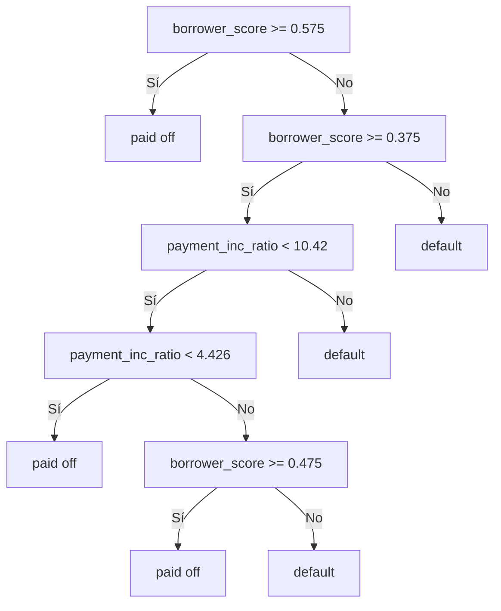

# Statical Machine Learning

## K-Nearest Neighbors

### 1. Introducción

**K-Nearest Neighbors (KNN)**, o **K vecinos más cercanos**, predice una observación a partir de los casos conocidos que más se le parecen. Por ejemplo, para estimar si una persona devolverá un préstamo, busca personas con características similares y observa qué ocurrió con sus préstamos.

Es un método de **aprendizaje supervisado**: necesita datos con una respuesta conocida. No ajusta una ecuación global como la regresión; conserva los ejemplos de entrenamiento y calcula las distancias cuando necesita predecir. Por eso se considera un método de aprendizaje basado en instancias.

| Elemento | Qué es |
| --- | --- |
| Observación | Una fila de datos, por ejemplo, un préstamo. |
| Predictores | Las variables utilizadas para comparar observaciones. |
| Distancia | La medida numérica de qué tan diferentes son dos observaciones. |
| $K$ | La cantidad de vecinos que participan en la predicción. |
| Respuesta | La clase o el valor numérico que se quiere predecir. |

El procedimiento tiene tres pasos: calcular las distancias al caso nuevo, seleccionar los $K$ casos más cercanos y combinar sus respuestas. En **clasificación** se elige la clase más frecuente; en **regresión** se puede promediar el valor de los vecinos. En la versión sin ponderación, cada vecino tiene el mismo voto.

Si $N_K(x)$ representa los vecinos de una observación $x$, la probabilidad estimada de una clase $c$ es:

$$
\widehat{P}(Y=c\mid x)=\frac{1}{K}\sum_{i\in N_K(x)}\mathbf{1}(y_i=c)
$$

La expresión cuenta cuántos vecinos pertenecen a esa clase y divide entre $K$. Es una proporción local, no una garantía de lo que ocurrirá con una persona concreta.

---

### 2. A Small Example: Predicting Loan Default

El capítulo 6 de *Practical Statistics for Data Scientists* presenta un ejemplo con `loan200`, una muestra de 200 préstamos. La respuesta `outcome` distingue entre **`paid off`**, préstamo pagado, y **`default`**, incumplimiento de pago. Se reserva el primer préstamo para predecirlo usando los otros 199 y se buscan sus 20 vecinos más cercanos.

#### 2.1 Variables del ejemplo: DTI y payment_inc_ratio

| Variable | Qué representa |
| --- | --- |
| **DTI (`dti`, debt-to-income)** | Relación entre los pagos mensuales de las deudas y el ingreso mensual del prestatario, expresada en porcentaje. Resume la carga de deuda respecto de sus ingresos. |
| **`payment_inc_ratio`** | Relación entre la cuota del préstamo solicitado y el ingreso mensual, también expresada en porcentaje. Resume cuánto del ingreso exige ese préstamo. |

La diferencia es que DTI considera la carga de las deudas, mientras que `payment_inc_ratio` se concentra en la cuota del préstamo analizado. Como ejemplo ilustrativo, una cuota de 200 y un ingreso mensual de 2000 dan `payment_inc_ratio = 10`, es decir, 10 %.

#### 2.2 Preparación para ejecutar los ejemplos

Los cuatro bloques de ejemplos que siguen son extractos del **código Python oficial del capítulo 6**, conservados sin modificar. La preparación siguiente es una adaptación mínima para ejecutarlos en orden: se necesitan `pandas`, `scikit-learn` y los archivos `loan200.csv` y `loan_data.csv.gz` del directorio `data` del repositorio del libro.

```python
from pathlib import Path
import pandas as pd
from sklearn import preprocessing
from sklearn.neighbors import KNeighborsClassifier

DATA = Path('data')
LOAN200_CSV = DATA / 'loan200.csv'
LOAN_DATA_CSV = DATA / 'loan_data.csv.gz'
```

**Comentario del bloque:** prepara la lectura de datos y las herramientas de KNN y estandarización. Si los archivos están en otra carpeta, se cambia `DATA`; esta preparación no entrena ningún modelo.

#### 2.3 Código: predecir el impago

```python
loan200 = pd.read_csv(LOAN200_CSV)
 
predictors = ['payment_inc_ratio', 'dti']
outcome = 'outcome'


newloan = loan200.loc[0:0, predictors]
X = loan200.loc[1:, predictors]
y = loan200.loc[1:, outcome]

knn = KNeighborsClassifier(n_neighbors=20)
knn.fit(X, y)
knn.predict(newloan)
print(knn.predict_proba(newloan))
```

**Comentario del bloque:** separa el primer préstamo, entrena KNN con los otros 199 y consulta sus 20 vecinos para obtener una clase y las probabilidades. La observación que se predice queda fuera del entrenamiento, así que no puede votar por sí misma. `predict` devuelve la clase; `predict_proba` devuelve las proporciones por clase en el orden de `knn.classes_`.

En un ejemplo ilustrativo, si 12 de los 20 vecinos pagaron y 8 incumplieron, la predicción sería `paid off`, con una proporción de pago de $12/20=0.60$. Estos números explican la votación; no se presentan como una salida ejecutada del archivo.

---

### 3. Distance Metrics: Euclidean y Manhattan

La elección de distancia define quién cuenta como vecino. Para dos observaciones $x=(x_1,\ldots,x_p)$ y $z=(z_1,\ldots,z_p)$, con $p$ predictores:

#### 3.1 Distancia euclidiana (Euclidean)

$$
d_E(x,z)=\sqrt{\sum_{j=1}^{p}(x_j-z_j)^2}
$$

Es la distancia en línea recta. Se restan los valores de cada variable, se elevan al cuadrado, se suman y se obtiene la raíz cuadrada. En dos variables corresponde al teorema de Pitágoras.

#### 3.2 Distancia Manhattan

$$
d_M(x,z)=\sum_{j=1}^{p}|x_j-z_j|
$$

Suma las diferencias absolutas, como recorrer calles horizontales y verticales de una cuadrícula. No eleva las diferencias al cuadrado, por lo que las diferencias grandes tienen menos peso relativo que en la distancia euclidiana.

Por ejemplo, entre $(1,2)$ y $(4,6)$ la distancia euclidiana es $\sqrt{3^2+4^2}=5$, mientras que Manhattan es $3+4=7$. Ambas miden cercanía, pero pueden producir conjuntos de vecinos diferentes.

En `KNeighborsClassifier`, la configuración predeterminada usa Minkowski con `p=2`, equivalente a Euclidean; con `p=1` equivale a Manhattan. Estas son **métricas de distancia**, no medidas de acierto del modelo. El error de clasificación se evalúa aparte con datos no usados para entrenar.

---

### 4. One Hot Encoder

KNN necesita comparar valores numéricos. Si una variable tiene categorías sin orden, como el propósito de un préstamo, asignarles números 1, 2 y 3 inventaría una distancia y un orden que no existen.

**One-hot encoding** crea una columna por categoría y utiliza 1 si la observación pertenece a ella y 0 si no:

| Propósito | automóvil | educación | vivienda |
| --- | --- | --- | --- |
| automóvil | 1 | 0 | 0 |
| educación | 0 | 1 | 0 |
| vivienda | 0 | 0 | 1 |

En Python se puede hacer con `OneHotEncoder` o `pd.get_dummies`. Para KNN, conservar todas las columnas permite tratar simétricamente las categorías: entre dos categorías distintas del ejemplo, la distancia euclidiana es $\sqrt{2}$. La codificación se aprende con los datos de entrenamiento y se aplica de la misma manera a los casos nuevos.

El ejemplo inicial no necesita esta transformación porque `dti` y `payment_inc_ratio` ya son numéricos. Convertir categorías en columnas tampoco resuelve por sí solo las diferencias de escala con las demás variables.

---

### 5. Standardization (Normalization, Z-Scores)

La distancia depende de las unidades. Si una variable representa dinero en miles y otra un porcentaje, la primera puede dominar la búsqueda de vecinos aunque no sea más útil para predecir. En el ejemplo ampliado aparecen `revol_bal`, saldo de crédito revolvente, y `revol_util`, porcentaje de utilización de ese crédito.

#### 5.1 Búsqueda de vecinos antes de estandarizar

```python
loan_data = pd.read_csv(LOAN_DATA_CSV)
loan_data = loan_data.drop(columns=['Unnamed: 0', 'status'])
loan_data['outcome'] = pd.Categorical(loan_data['outcome'], 
                                      categories=['paid off', 'default'], 
                                      ordered=True)


predictors = ['payment_inc_ratio', 'dti', 'revol_bal', 'revol_util']
outcome = 'outcome'

newloan = loan_data.loc[0:0, predictors]
print(newloan)
X = loan_data.loc[1:, predictors]
y = loan_data.loc[1:, outcome]

knn = KNeighborsClassifier(n_neighbors=5)
knn.fit(X, y)

nbrs = knn.kneighbors(newloan)
print(X.iloc[nbrs[1][0], :])
```

**Comentario del bloque:** carga los préstamos y busca cinco vecinos usando cuatro predictores en sus unidades originales. Imprime las características de esos vecinos para observar el efecto de la escala: las diferencias de `revol_bal` pueden pesar mucho más que las diferencias entre porcentajes. `kneighbors` devuelve distancias y posiciones; esas posiciones permiten recuperar las filas con `iloc`.

#### 5.2 Estandarización mediante z-scores

La estandarización transforma cada variable restando su media y dividiendo entre su desviación estándar:

$$
z_{ij}=\frac{x_{ij}-\mu_j}{\sigma_j}
$$

Aquí $\mu_j$ y $\sigma_j$ se calculan con los datos de entrenamiento. Un valor transformado de 2 significa que está dos desviaciones estándar por encima de la media. Las variables no constantes quedan con media 0 y desviación estándar 1 en entrenamiento. Esto pone sus escalas en condiciones comparables; no convierte sus distribuciones en normales ni elimina los valores atípicos.

El capítulo agrupa este tema bajo *Standardization (Normalization, Z-Scores)*. Conviene distinguirlo de la normalización **min-max**, que transforma los datos de entrenamiento al intervalo $[0,1]$:

$$
x'_{ij}=\frac{x_{ij}-\min(X_j)}{\max(X_j)-\min(X_j)}
$$

Los z-scores no están limitados a ese intervalo. Ambos métodos cambian la escala, pero lo hacen con referencias diferentes.

#### 5.3 Código: StandardScaler y nuevos vecinos

```python
newloan = loan_data.loc[0:0, predictors]
X = loan_data.loc[1:, predictors]
y = loan_data.loc[1:, outcome]

scaler = preprocessing.StandardScaler()
scaler.fit(X * 1.0)

X_std = scaler.transform(X * 1.0)
newloan_std = scaler.transform(newloan * 1.0)

knn = KNeighborsClassifier(n_neighbors=5)
knn.fit(X_std, y)

nbrs = knn.kneighbors(newloan_std)
print(X.iloc[nbrs[1][0], :])
```

**Comentario del bloque:** aprende la media y la desviación de los datos de entrenamiento con `StandardScaler`, transforma tanto esos datos como el préstamo reservado y vuelve a buscar cinco vecinos. Ahora la distancia compara desviaciones respecto de la escala de cada variable. La tabla final muestra los vecinos en sus unidades originales para facilitar la comparación con el bloque anterior.

El escalador se ajusta solo con `X`; al préstamo nuevo se le aplica la transformación ya aprendida. En validación cruzada debe repetirse este procedimiento dentro de cada pliegue para no utilizar información de la parte reservada para validar.

---

### 6. Choosing K: overfitting y oversmoothing

$K$ controla cuánto detalle local utiliza el modelo. No existe un valor que funcione mejor en todos los problemas.

| Elección | Qué ocurre | Riesgo |
| --- | --- | --- |
| $K$ pequeño, por ejemplo 1 | La respuesta depende de muy pocos casos y cambia fácilmente ante pequeñas variaciones. | **Overfitting** o sobreajuste: aprende también el ruido; baja el sesgo y aumenta la varianza. |
| $K$ intermedio | Combina suficientes vecinos sin borrar todas las diferencias locales. | Puede equilibrar sesgo y varianza; se comprueba mediante validación. |
| $K$ muy grande | Mezcla observaciones cada vez más alejadas y produce fronteras más suaves. | **Oversmoothing**, suavizado excesivo: pierde patrones relevantes; aumenta el sesgo y puede causar subajuste. |

Si $K$ llega al total de observaciones de entrenamiento, todos los casos nuevos reciben la misma votación global. En clasificación, terminarían prediciéndose según la clase mayoritaria, salvo empates.

Para elegirlo se prueban varios valores mediante **validación cruzada**, manteniendo separado un conjunto final de prueba. Una medida sencilla es la proporción de errores:

$$
\text{Error}=\frac{\text{número de predicciones incorrectas}}{\text{número de observaciones evaluadas}}
$$

En problemas con clases desbalanceadas también interesa revisar la matriz de confusión, precisión, recall y F1. Los valores 20 y 5 de los ejemplos ilustran el procedimiento; no implican que sean óptimos para cualquier conjunto de préstamos. Usar un $K$ impar puede evitar empates de votos en clasificación binaria sin ponderación, pero no reemplaza la validación.

---

### 7. KNN as a Feature Engine

KNN también puede servir para **crear una variable predictora**. En lugar de usar su respuesta como decisión final, se resume la información de varios atributos en un puntaje y se entrega ese puntaje a otro modelo.

El capítulo construye `borrower_score` a partir de `dti`, `revol_bal`, `revol_util`, `open_acc` y los indicadores `delinq_2yrs_zero` y `pub_rec_zero`. En conjunto describen deuda, utilización del crédito, cuentas abiertas y antecedentes crediticios. La proporción de impagos entre vecinos sintetiza el perfil del prestatario y puede incorporarse a una regresión logística o a un árbol junto con variables como `payment_inc_ratio`.

#### 7.1 Código: borrower_score y predict_proba

El siguiente extracto conserva la versión actual del repositorio oficial, omitiendo únicamente las instrucciones de la gráfica:

```python
loan_data = pd.read_csv(LOAN_DATA_CSV)
loan_data = loan_data.drop(columns=['Unnamed: 0', 'status'])
loan_data['outcome'] = pd.Categorical(loan_data['outcome'], 
                                      categories=['paid off', 'default'], 
                                      ordered=True)

predictors = ['dti', 'revol_bal', 'revol_util', 'open_acc', 
              'delinq_2yrs_zero', 'pub_rec_zero']
outcome = 'outcome'

X = loan_data[predictors]
y = loan_data[outcome]

knn = KNeighborsClassifier(n_neighbors=20)
knn.fit(X, y)
loan_data['borrower_score'] = knn.predict_proba(X)[:, 0]
print(loan_data['borrower_score'].describe())
```

**Comentario del bloque:** entrena KNN con seis atributos, calcula para cada observación la proporción de una clase entre sus 20 vecinos y la guarda como `borrower_score`. `describe` resume la distribución del puntaje. Así, la salida de un modelo se convierte en la entrada de otro: esa es la relación con la ingeniería de características.

**Interpretación del puntaje.** Las columnas de `predict_proba` siguen el orden de `knn.classes_`. Con estas etiquetas de texto, scikit-learn ordena las clases como `['default', 'paid off']`: `[:, 0]` corresponde a impago y `[:, 1]` a pago. La versión actual del código oficial usa `[:, 0]`; si se consulta una edición que muestra `[:, 1]`, debe interpretarse esa columna según la clase correspondiente. Un puntaje alto solo significa mayor riesgo cuando se toma la probabilidad de `default`.

**Alcance del ejemplo.** Este bloque original no estandariza sus seis atributos y predice sobre los mismos datos con los que se ajustó, por lo que cada fila puede aparecer entre sus propios vecinos. Ilustra cómo crear la variable, pero no mide el rendimiento con casos nuevos. Para usarla al entrenar otro modelo, conviene generar los puntajes fuera de muestra, por pliegues, ajustando también el preprocesamiento dentro de cada pliegue. Así se evita que la respuesta de una fila influya en su propio puntaje.

---

### 8. Conclusiones

- KNN predice comparando con observaciones conocidas y combinando las respuestas de sus vecinos.
- La distancia, la codificación de categorías y la escala de las variables determinan qué significa parecerse.
- Un $K$ pequeño puede sobreajustar; uno demasiado grande puede suavizar en exceso. Se elige con validación.
- `predict_proba` expresa proporciones por clase y debe leerse junto con `classes_`.
- KNN puede producir una predicción final o generar una característica como `borrower_score` para otros modelos.

**Fuente:** Peter Bruce, Andrew Bruce y Peter Gedeck, *Practical Statistics for Data Scientists*, 2.ª edición, capítulo 6, sección K-Nearest Neighbors. Los extractos de Python proceden del [código oficial del capítulo 6](https://github.com/gedeck/practical-statistics-for-data-scientists/blob/master/python/code/Chapter%206%20-%20Statistical%20Machine%20Learning.py), © 2019 Peter C. Bruce, Andrew Bruce y Peter Gedeck, publicado bajo [GNU GPL v3](https://github.com/gedeck/practical-statistics-for-data-scientists/blob/master/LICENSE). Las explicaciones en español son una síntesis propia. Referencias de implementación: [KNeighborsClassifier](https://scikit-learn.org/stable/modules/generated/sklearn.neighbors.KNeighborsClassifier.html), [StandardScaler](https://scikit-learn.org/stable/modules/generated/sklearn.preprocessing.StandardScaler.html) y [OneHotEncoder](https://scikit-learn.org/stable/modules/generated/sklearn.preprocessing.OneHotEncoder.html).

## Tree  Models

Los **modelos de árbol**, también llamados **CART** (*Classification and Regression Trees*), árboles de decisión o simplemente árboles, son un método popular de clasificación y regresión desarrollado por Leo Breiman y colaboradores en 1984. Son un conjunto de reglas **"si-entonces-sino"** fáciles de entender e implementar, y pueden descubrir patrones ocultos e interacciones complejas entre variables. Sus descendientes, **Random Forest** y **Boosted Trees**, son de las herramientas predictivas más usadas en ciencia de datos.

### Términos clave

| Término | Definición |
| --- | --- |
| **Recursive partitioning** | Dividir y subdividir los datos para que los resultados en cada subdivisión final sean lo más homogéneos posible. |
| **Split value** | Valor de un predictor que separa los registros en menores y mayores a ese valor. |
| **Node** | Representación gráfica o en reglas de un valor de corte. |
| **Leaf** | Final de un conjunto de reglas; las reglas que llevan a ella clasifican un registro. |
| **Loss** | Número de clasificaciones erróneas en una etapa de la división (más pérdidas = más impureza). |
| **Impurity** | Grado de mezcla de clases en una partición (sinónimo: heterogeneidad; antónimos: homogeneidad, pureza). |
| **Pruning** | Recortar progresivamente las ramas de un árbol completamente crecido para reducir el sobreajuste. |

### Un ejemplo simple

El libro ajusta un árbol con 3,000 registros de préstamos (`loan3000`) usando `borrower_score` y `payment_inc_ratio`:

```python
from sklearn.tree import DecisionTreeClassifier

predictors = ['borrower_score', 'payment_inc_ratio']
X = loan3000[predictors]
y = loan3000['outcome']

loan_tree = DecisionTreeClassifier(random_state=1, criterion='entropy',
                                   min_impurity_decrease=0.003)
loan_tree.fit(X, y)
```

Las reglas se recorren desde la **raíz**, yendo a la izquierda si la condición es verdadera y a la derecha si no, hasta llegar a una **hoja**.



Un préstamo con `borrower_score = 0.6` y `payment_inc_ratio = 8.0` cumple la primera regla y cae en la hoja de la izquierda: se predice **"paid off"**.

### El algoritmo de particionado recursivo

Para una partición $A$ y predictores $X_j$ ($j = 1, \dots, P$), el algoritmo busca la mejor forma de dividirla en dos:

1. Para cada predictor $X_j$ y cada valor $s_j$: separar los registros con $X_j < s_j$ de los que cumplen $X_j \ge s_j$ y medir la homogeneidad de cada subpartición.
2. Elegir la variable $X_j$ y el valor $s_j$ que dan la **máxima homogeneidad**.

La parte recursiva:

1. Inicializar $A$ con todo el conjunto de datos.
2. Dividir $A$ en dos subparticiones, $A_1$ y $A_2$.
3. Repetir el paso 2 sobre $A_1$ y $A_2$.
4. Terminar cuando ninguna partición mejore lo suficiente la homogeneidad.

Cada partición final predice por **voto mayoritario**. También puede dar una probabilidad: $\text{Prob}(Y=1) = \dfrac{\text{número de 1s en la partición}}{\text{tamaño de la partición}}$.

### Medir homogeneidad o impureza

La exactitud no es una buena medida de impureza. Las dos más usadas (caso binario, con $p$ la proporción de registros mal clasificados) son:

$$
\text{Gini: } I(A) = p(1-p) \qquad\qquad \text{Entropía: } I(A) = -p\log_2(p) - (1-p)\log_2(1-p)
$$

Son parecidas; la entropía da valores más altos para $p$ moderados y altos. Para cada corte propuesto se calcula el **promedio ponderado** de la impureza de las subparticiones, y se elige el corte con el menor valor.

> No confundir la *impureza de Gini* con el *coeficiente de Gini*, que se limita al caso binario y se relaciona con el AUC.

### Evitar que el árbol crezca demasiado

Un árbol completamente crecido tiene hojas 100 % puras en entrenamiento, pero esa exactitud es ilusoria: es **sobreajuste** (ajusta el ruido, no la señal). Formas de detener el crecimiento:

| Estrategia | `rpart` (R) | `scikit-learn` (Python) |
| --- | --- | --- |
| Evitar particiones u hojas muy pequeñas | `minsplit` (20), `minbucket` (7) | `min_samples_split` (2), `min_samples_leaf` (1) |
| No dividir si no reduce la impureza lo suficiente | `cp` (0.01) | `min_impurity_decrease` |

Estas reglas son arbitrarias, así que se combinan con **validación cruzada**:

- **En R**, se busca el `cp` con el menor error de validación cruzada (`xerror` en `cptable`), podando el árbol.
- **En Python**, `scikit-learn` no tiene poda ni parámetro de complejidad; se usa `GridSearchCV` sobre combinaciones de `max_depth` y `min_samples_split`.

### Predicción de un valor continuo

La regresión con árboles sigue el mismo procedimiento, pero la impureza se mide con las **desviaciones al cuadrado respecto a la media** en cada subpartición, y el desempeño con el **RMSE**:

$$
\text{RMSE} = \sqrt{\frac{1}{n}\sum_{i=1}^{n}(y_i - \hat{y}_i)^2}
$$

En `scikit-learn` se usa `DecisionTreeRegressor`.

#### Extensión: Model Tree

Un árbol de regresión predice en cada hoja un **promedio (constante)**, lo que produce un ajuste en escalones. Un **Model Tree** (estilo M5) mantiene el particionado, pero **ajusta una regresión lineal en cada hoja**, por lo que aproxima con rectas por tramos y necesita menos cortes. Se parte con la **reducción de desviación estándar (SDR)**:

$$
\text{SDR} = \sigma(y) - \frac{n_L}{n}\sigma(y_L) - \frac{n_R}{n}\sigma(y_R)
$$

Flujo: **1.** particionado recursivo → **2.** predicción en hojas (modelo lineal) → **3.** evaluación con RMSE → **4.** implementación en Python.

```python
import numpy as np

class Node:
    def __init__(self):
        self.is_leaf, self.feature, self.threshold = False, None, None
        self.left = self.right = self.coef = None

def sdr(y, yl, yr):                                   # criterio de corte
    n = len(y)
    return np.std(y) - len(yl)/n*np.std(yl) - len(yr)/n*np.std(yr)

def make_leaf(node, X, y):                            # hoja = regresión lineal
    A = np.column_stack([np.ones(len(X)), X])
    node.coef, *_ = np.linalg.lstsq(A, y, rcond=None)
    node.is_leaf = True
    return node

def build_tree(X, y, depth=0, max_depth=3, min_leaf=15):   # particionado recursivo
    node = Node()
    if depth >= max_depth or len(y) < 2 * min_leaf:
        return make_leaf(node, X, y)
    best = (None, None, 0.0)
    for j in range(X.shape[1]):
        v = np.unique(X[:, j])
        for t in (v[:-1] + v[1:]) / 2:
            m = X[:, j] <= t
            if m.sum() < min_leaf or (~m).sum() < min_leaf:
                continue
            g = sdr(y, y[m], y[~m])
            if g > best[2]:
                best = (j, t, g)
    if best[0] is None:
        return make_leaf(node, X, y)
    m = X[:, best[0]] <= best[1]
    node.feature, node.threshold = best[0], best[1]
    node.left = build_tree(X[m], y[m], depth + 1, max_depth, min_leaf)
    node.right = build_tree(X[~m], y[~m], depth + 1, max_depth, min_leaf)
    return node

def predict(tree, X):                                 # recorrer hasta la hoja
    out = []
    for x in X:
        node = tree
        while not node.is_leaf:
            node = node.left if x[node.feature] <= node.threshold else node.right
        out.append(node.coef[0] + node.coef[1:] @ x)
    return np.array(out)

rmse = lambda y, p: np.sqrt(np.mean((y - p) ** 2))    # evaluación

tree = build_tree(X_train, y_train)
print("RMSE prueba:", rmse(y_test, predict(tree, X_test)))
```

### Cómo se usan los árboles

- Son una **herramienta visual** para explorar los datos, ver qué variables importan y capturar relaciones no lineales.
- Dan **reglas** que se pueden comunicar a no especialistas, lo que reduce la percepción de "caja negra".
- Para predecir, usar varios árboles (**Random Forest**, **Boosted Trees**) suele ser más exacto, pero se pierde la interpretabilidad de un árbol único.

### Ideas clave

- Los árboles producen un **conjunto de reglas** mediante particiones sucesivas de los datos.
- En cada etapa se elige la división que **minimiza la impureza** en cada subpartición.
- Un árbol completamente crecido **sobreajusta**: hay que podarlo o limitarlo con hiperparámetros y validación cruzada.
- En regresión, la impureza se mide con errores cuadráticos y el desempeño con **RMSE**; un **Model Tree** reemplaza el promedio de cada hoja por un modelo lineal.
- Los métodos de múltiples árboles mejoran la predicción, pero pierden la interpretabilidad.

## Bagging and the Ramdom Forest

### 1. Introducción

Los métodos de ensamble (ensemble learning) parten de la analogía del experimento de Sir Francis Galton (1906) sobre la "sabiduría de las multitudes" (Wisdom of Crowds), donde el promedio de múltiples estimaciones individuales supera en precisión a cualquier estimación aislada. En árboles de decisión, combinar las predicciones de múltiples modelos reduce significativamente la varianza sin aumentar el sesgo.

### 2. Bagging (Bootstrap Aggregating)

Introducido por Leo Breiman en 1996, el Bagging consiste en entrenar múltiples modelos predictivos de forma independiente utilizando diferentes submuestras de datos generadas mediante muestreo bootstrap (muestreo aleatorio con reemplazo)

#### 2.1. Definición matemática y algoritmo

Dado un conjunto de entrenamiento con $$N$$ registros y $$P$$ variables predictoras $$X = (X_1, X_2, \dots, X_P)$$:

1. Se fijan $$M$$ (número de modelos) y $$n$$ ($$n < N$$, tamaño del subsistema).
2. Para cada iteración $$m = 1, \dots, M$$:
   - Se extrae una muestra bootstrap de tamaño $$n$$ con reemplazo para formar la submuestra $$(Y_m, X_m)$$.
   - Se entrena un modelo individual para obtener la regla de decisión $$f_m(X)$$.
3. **Predicción Agregada**:
   - **Regresión o Estimación de Probabilidades**:

$$\hat{f}(X) = \frac{1}{M} \sum_{m=1}^{M} f_m(X)$$

- **Clasificación**: Se aplica **voto mayoritario** (*majority vote*) sobre las predicciones de las $$M$$ reglas $$f_m(X)$$.

#### 2.2. Ejemplo

```python
from sklearn.ensemble import BaggingClassifier
from sklearn.tree import DecisionTreeClassifier

# Definición del modelo de Bagging con 500 árboles de decisión
modelo_bagging = BaggingClassifier(
    estimator=DecisionTreeClassifier(),
    n_estimators=500,
    random_state=1
)

# Entrenamiento del modelo
getattr(modelo_bagging, 'fit')(X_train, y_train)

# Predicción
y_pred = modelo_bagging.predict(X_test)
```

### 3. Random Forest

El Random Forest extiende el principio de bagging sobre árboles de decisión agregando una segunda capa de aleatorización: la selección aleatoria de variables (*feature sampling*) en cada división de nodo (*split*). Esto descorrelaciona los árboles entre sí, reduciendo la varianza global del ensemble de manera más efectiva que el bagging simple.

#### 3.1 Definición matemática y algoritmo

1. Se extrae una muestra bootstrap con reemplazo del conjunto de datos.
2. En cada división de nodo, en lugar de evaluar los $$P$$ predictores disponibles, el algoritmo selecciona al azar un subconjunto de $$p < P$$ variables sin reemplazo.
   - **Regla empírica recomendada**: $$p = \sqrt{P}$$ para problemas de clasificación.
3. Se evalúa el criterio de división (p. ej., minimización de la **Impureza Gini** o **Entropía**) únicamente dentro de las $$p$$ variables elegidas para determinar el corte óptimo $$s_{j_k}$$.
4. Se hace crecer el árbol completamente sin podar.
5. Se repite el proceso para los $$M$$ árboles y se promedian/votan los resultados:

$$\hat{f}_{rf}(X) = \frac{1}{M} \sum_{m=1}^{M} f_m(X; \theta_m)$$

(donde $$\theta_m$$ representa la aleatorización tanto de datos como de variables en el árbol $$m$$ ).

#### 3.2. Ejemplo

```python
from sklearn.ensemble import RandomForestClassifier

# Crear el modelo de Random Forest con selección aleatoria de variables
rf = RandomForestClassifier(
    n_estimators=500,
    max_features='sqrt',  # mtry = sqrt(P) para clasificación
    random_state=1,
    oob_score=True
)

# Entrenamiento del modelo
getattr(rf, 'fit')(X_train, y_train)

# Evaluación fuera de bolsa (Out-of-Bag)
print(f"Precisión Out-of-Bag (OOB): {rf.oob_score_:.4f}")

# Predicción
y_pred = rf.predict(X_test)
```

## Boosting

### 1. Introducción

El boosting es una técnica para crear un ensamble de modelos, es decir, un conjunto de modelos cuyas predicciones se combinan. Se usa casi siempre con árboles de decisión. A diferencia del bagging y del bosque aleatorio, donde los modelos se entrenan por separado, en el boosting se entrenan en secuencia: cada modelo nuevo trata de reducir el error del anterior. Por eso requiere más ajuste de parámetros que el bagging.

Existen tres variantes principales:

| Variante | Descripción |
| --- | --- |
| AdaBoost | Aumenta el peso de las observaciones mal clasificadas para que el siguiente modelo se concentre en ellas. |
| Gradient boosting | Plantea el problema como la minimización de una función de costo. Cada modelo nuevo se ajusta al pseudo-residuo, es decir, a lo que aún no explica el conjunto. |
| Stochastic gradient boosting | Igual que el anterior, pero en cada ronda usa una muestra aleatoria de filas y de columnas. Es la variante más general y la más usada. |

### 2. Comprenderlo matemáticamente

Esta parte explica las fórmulas con palabras y con números sencillos. Lo importante es la idea de fondo: en cada ronda se entrena un modelo, se ve dónde se equivocó y el siguiente modelo se encarga de corregir eso.

#### 2.1 Notación

| Símbolo | Significado |
| --- | --- |
| $N$ | Número de filas, o sea, observaciones |
| $i$ | Número de una fila, $i = 1, 2, \dots, N$ |
| $M$ | Número máximo de modelos |
| $m$ | Número del modelo actual, $m = 1, 2, \dots, M$ |
| $w_i$ | Peso de la fila $i$, que indica qué tan importante es esa fila |
| $f_m$ | Modelo número $m$ |
| $F_m$ | Ensamble formado por los primeros $m$ modelos |
| $e_m$ | Error ponderado del modelo $m$ |
| $\alpha_m$ | Peso o confianza del modelo $m$ |
| $y_i$ | Valor real de la fila $i$ |
| $\eta$ | Factor de contracción, un número entre 0 y 1 |
| $K$ | Número de pliegues de la validación cruzada |

#### 2.2 AdaBoost

La idea de AdaBoost en pocas palabras: se entrena un modelo, se mira qué filas clasificó mal, se les sube la importancia, es decir, el peso, y se entrena el siguiente modelo con esos pesos nuevos. Así el siguiente modelo se esfuerza más en las filas difíciles. Al final se combinan todos los modelos, y los que se equivocaron menos tienen más voz.

Se explica paso a paso con un ejemplo de 5 observaciones llamadas A, B, C, D y E.

**Paso 1. Todas las filas empiezan con el mismo peso.**

$$w_i = \frac{1}{N} \qquad F_0 = 0$$

Si hay $N$ filas, cada una pesa $1/N$, así ninguna tiene ventaja al principio. $F_0 = 0$ quiere decir que el ensamble empieza vacío y todavía no predice nada.

Ejemplo: con 5 observaciones, cada una pesa $1/5 = 0.2$.

**Paso 2. Medir cuánto se equivoca el modelo.** Se entrena el modelo $f_m$ usando los pesos y se calcula su error ponderado:

$$e_m = \sum_{i\ \text{mal clasificadas}} w_i$$

Se suman solo los pesos de las filas que el modelo clasificó mal. Las que acertó no cuentan.

Ejemplo: el primer modelo solo falla en D, que pesa 0.2, así que $e_1 = 0.2$. Si hubiera fallado en D y en A, sería $0.2 + 0.2 = 0.4$.

**Paso 3. Decidir cuánta confianza se le da al modelo.**

$$\alpha_m = \ln\!\left(\frac{1 - e_m}{e_m}\right)$$

Aquí $\ln$ es el logaritmo natural. Lo que importa es cómo se comporta: si el error es minimo, $\alpha_m$ sale grande, y si el error es grande, sale minimo.

Ejemplo con $e_1 = 0.2$: $\alpha_1 = \log(0.8 / 0.2) = \log(4) \approx 1.39$.

| Error $e_m$ | 0.1 | 0.2 | 0.3 | 0.4 | 0.5 |
|---|---|---|---|---|---|
| Confianza $\alpha_m$ | 2.20 | 1.39 | 0.85 | 0.41 | 0 |

Con un error de 0.5 la confianza es 0: el modelo acierta tanto como una moneda al aire, así que no aporta nada.

**Paso 4. Agregar el modelo al ensamble.**

$$F_m = F_{m-1} + \alpha_m f_m$$

El ensamble nuevo es el ensamble anterior más el modelo nuevo, y el modelo nuevo entra multiplicado por su confianza.

**Paso 5. Subir el peso de las filas que falló.** Los pesos de las filas mal clasificadas aumentan según $\alpha_m$. La forma habitual de hacerlo es multiplicar el peso de esas filas por $e^{\alpha_m}$ y después reescalar:

$$w_i \leftarrow w_i \cdot e^{\alpha_m} \quad \text{(solo si la fila } i \text{ fue mal clasificada)}$$

Reescalar quiere decir dividir cada peso entre la suma de todos, para que los pesos vuelvan a sumar 1.

Ejemplo: $e^{1.39} \approx 4$, así que el peso de D se multiplica por 4.

| Observación | A | B | C | D mal clasificada | E | Suma |
| --- | --- | --- | --- | --- | --- | --- |
| Peso antes | 0.2 | 0.2 | 0.2 | 0.2 | 0.2 | 1 |
| Peso multiplicado | 0.2 | 0.2 | 0.2 | 0.8 | 0.2 | 1.6 |
| Peso reescalado entre 1.6 | 0.125 | 0.125 | 0.125 | 0.5 | 0.125 | 1 |

Ahora D pesa la mitad de todo, y el segundo modelo se esfuerza sobre todo por acertar D.

**Paso 6. Repetir** hasta tener los $M$ modelos. La predicción final es la suma de todos, cada uno multiplicado por su confianza:

$$F = \alpha_1 f_1 + \alpha_2 f_2 + \cdots + \alpha_M f_M$$

**Ejemplo con dos modelos.** Supongamos que el segundo modelo, entrenado con los pesos nuevos, solo falla en A:

| | A | B | C | D | E | Error | Confianza |
| --- | --- | --- | --- | --- | --- | --- | --- |
| Pesos con que entrena el modelo 1 | 0.2 | 0.2 | 0.2 | 0.2 | 0.2 | $e_1 = 0.2$, falla D | $\alpha_1 = 1.39$ |
| Pesos con que entrena el modelo 2 | 0.125 | 0.125 | 0.125 | 0.5 | 0.125 | $e_2 = 0.125$, falla A | $\alpha_2 = \log(7) \approx 1.95$ |

Para un caso nuevo, con las dos clases codificadas como $+1$ y $-1$, el modelo 1 predice $+1$ y el modelo 2 predice $-1$:

$$F = 1.39 \times (+1) + 1.95 \times (-1) = -0.56$$

El resultado es negativo, así que la predicción final es $-1$. Gana el modelo 2 porque tiene más confianza, porque se equivocó menos. Es como una votación donde no todos los votos valen lo mismo.

#### 2.3 Gradient boosting

AdaBoost corrige cambiando los pesos de las filas. Gradient boosting hace otra cosa: mira cuánto se está equivocando el ensamble en cada fila, que es el residuo, entrena el siguiente modelo para predecir justamente ese error y lo suma al ensamble.

$$r_i = y_i - F_{m-1}(x_i) \qquad\qquad F_m = F_{m-1} + \eta\, h_m$$

- La primera fórmula dice: residuo = valor real − lo que predice el ensamble hasta ahora. Es lo que todavía falta.
- La segunda dice: el ensamble nuevo es el anterior más el modelo nuevo $h_m$, que aprendió a predecir ese residuo, multiplicado por $\eta$.
- $\eta$ es un número entre 0 y 1 que hace que cada modelo nuevo corrija solo una parte del error. Con $\eta = 0.5$ corrige la mitad, con $\eta = 0.1$ solo el 10 %.

Ejemplo: el valor real es 100, el primer modelo predice 80 y se usa $\eta = 0.5$. Para simplificar, se supone que cada árbol aprende exactamente el residuo.

| Ronda | Predicción del ensamble | Residuo, 100 menos la predicción | Lo que se suma, $0.5 \times$ residuo |
| --- | --- | --- | --- |
| 1 | 80 | 20 | 10 |
| 2 | 90 | 10 | 5 |
| 3 | 95 | 5 | 2.5 |
| 4 | 97.5 | 2.5 | 1.25 |

En la ronda 1 faltan 20, pero el árbol solo aporta la mitad, que es 10, y la predicción sube a 90. En la ronda 2 faltan 10, se suma la mitad, que es 5, y así sucesivamente. La predicción se acerca a 100 en cada ronda. Con un $\eta$ más pequeño el avance es más lento, pero el modelo se sobreajusta menos.

El pseudo-residuo es la versión general del residuo, para cuando el costo no es el error cuadrático. Se calcula con la derivada de la función de costo $L$:

$$r_i = -\frac{\partial L\big(y_i,\, F_{m-1}(x_i)\big)}{\partial F}$$

La derivada indica en qué dirección cambia el costo si se mueve la predicción, y el signo menos hace que se avance hacia donde el costo baja. Con el error cuadrático, $L = \tfrac{1}{2}(y - F)^2$, el resultado es justo $r_i = y_i - F_{m-1}(x_i)$, el residuo de arriba. En la práctica basta con entender el pseudo-residuo como "lo que le falta al ensamble".

#### 2.4 Regularización

Un modelo puede ajustarse tanto a los datos de entrenamiento que termina memorizando hasta el ruido, y luego falla con datos nuevos. Para evitarlo, la regularización suma al error un castigo por ser complicado:

$$\text{costo total} = \text{error del modelo} + \text{castigo por complejidad}$$

Hay dos tipos de castigo, y se escriben aquí para regresión, que es donde nació la idea.

Ridge o L2, castiga la suma de los coeficientes al cuadrado:

$$\sum_{i=1}^{n}\left(Y_i - b_0 - b_1 X_{i1} - \cdots - b_p X_{ip}\right)^2 + \lambda\left(b_1^2 + \cdots + b_p^2\right)$$

Lasso o L1, castiga la suma de los valores absolutos:

$$\sum_{i=1}^{n}\left(Y_i - b_0 - b_1 X_{i1} - \cdots - b_p X_{ip}\right)^2 + \alpha\left(|b_1| + \cdots + |b_p|\right)$$

Cómo leerlas:

- **Primer término, el error.** $b_0 + b_1 X_{i1} + \cdots$ es lo que predice el modelo para la fila $i$. Al restárselo al valor real $Y_i$ queda el error de esa fila; se eleva al cuadrado y se suman todas las filas.
- **Segundo término, el castigo.** Los $b$ son los coeficientes, los números que multiplican a cada variable. Mientras más grandes sean, más castigo.
- **$\lambda$ y $\alpha$** controlan qué tan fuerte es el castigo. Si valen 0, no hay castigo. Si son muy grandes, el modelo se ve obligado a usar coeficientes casi nulos.
- En XGBoost la idea es la misma y los parámetros se llaman lambda y alpha. Este $\alpha$ no tiene que ver con el $\alpha_m$ de AdaBoost.

Ejemplo con $b_1 = 3$, $b_2 = -2$ y un parámetro de castigo igual a 10:

| Tipo | Cálculo | Castigo |
| --- | --- | --- |
| L2 ridge | $10 \times (3^2 + (-2)^2) = 10 \times 13$ | 130 |
| L1 lasso | $10 \times (\lvert 3 \rvert + \lvert -2 \rvert) = 10 \times 5$ | 50 |

El modelo busca el menor costo total, así que le conviene bajar los coeficientes para reducir el castigo, aunque pierda un poco de precisión en el entrenamiento.

#### 2.5 Error y validación cruzada

**Error.** El código de los ejemplos mide el error así, con $p_i$ la probabilidad que predice el modelo y $y_i$ igual a 0 o 1:

$$\text{error} = \frac{1}{n}\sum_{i=1}^{n} \mathbf{1}\big(\,|y_i - p_i| > 0.5\,\big)$$

- $\mathbf{1}(\cdot)$ vale 1 si lo que está dentro se cumple y 0 si no.
- Para cada fila se calcula la diferencia entre el valor real y la probabilidad. Si pasa de 0.5, el modelo estaba más cerca de la clase equivocada y se cuenta como error.
- Al final se promedia: errores entre total de filas.

Ejemplo con 4 filas:

| Fila | Real $y$ | Predicción $p$ | $\lvert y - p \rvert$ | ¿Error? |
| --- | --- | --- | --- | --- |
| 1 | 1 | 0.9 | 0.1 | No |
| 2 | 0 | 0.2 | 0.2 | No |
| 3 | 0 | 0.6 | 0.6 | Sí |
| 4 | 1 | 0.4 | 0.6 | Sí |

Hay 2 errores en 4 filas, así que el error es $2/4 = 0.5$, es decir, 50 %.

**Validación cruzada.** Los datos se dividen en $K$ grupos llamados pliegues. Se entrena $K$ veces y en cada una se deja fuera un pliegue distinto para probar. Luego se promedian los errores de las $K$ pruebas:

$$\text{CV} = \frac{1}{K}\sum_{k=1}^{K} E_k$$

donde $E_k$ es el error medido en el pliegue $k$. Por ejemplo, con 5 pliegues y errores de 0.33, 0.32, 0.34, 0.33 y 0.33, la suma es 1.65 y el error de validación cruzada es $1.65 / 5 = 0.33$. Se repite para cada combinación de hiperparámetros y se elige la que da el menor CV.

---

### 3. Aplicación en el código

```python
import numpy as np
import pandas as pd
from xgboost import XGBClassifier
from sklearn.model_selection import train_test_split
from itertools import product
```

- **numpy**,  sirve para hacer cálculos con números, como promedios o números al azar.
- **pandas**,  sirve para trabajar con tablas de datos.
- **xgboost** trae el modelo de boosting. De ahí se importa la clase XGBClassifier.
- **scikit-learn**, ayuda a separar los datos en una parte para entrenar y otra para probar, con train_test_split.
- **itertools** permite armar todas las combinaciones posibles de valores con product, algo útil cuando se prueban varios hiperparámetros.

#### 3.1 Ejemplo

Detectar conexiones sospechosas en una red. De cada una se sabe cuántos intentos hace por minuto y a cuántos puertos distintos intenta entrar: una conexión normal usa uno o dos puertos, y quien escanea la red toca decenas. Hay 16 conexiones ya revisadas:

```python
datos = pd.DataFrame({
    'intentos_por_minuto': [2, 3, 5, 4, 6, 3, 2, 50, 80, 120, 90, 150, 70, 5, 60, 110],
    'puertos_distintos':   [1, 1, 2, 1, 2, 1, 1, 40, 60, 200, 35, 150, 80, 3, 25, 90],
    'sospechoso':          [0, 0, 0, 0, 0, 0, 0, 1, 1, 1, 1, 1, 1, 0, 1, 1]
})

X = datos[['intentos_por_minuto', 'puertos_distintos']]
y = datos['sospechoso']

modelo = XGBClassifier(objective='binary:logistic', n_estimators=50,
                       max_depth=2, learning_rate=0.3)
modelo.fit(X, y)

nuevos = pd.DataFrame({'intentos_por_minuto': [90, 4], 'puertos_distintos': [45, 2]})

print(modelo.predict_proba(nuevos)[:, 1])
print(modelo.predict(nuevos))
```

La columna sospechoso vale 1 si la conexión era un ataque y 0 si era normal. Es la que se quiere predecir, así que va en y, y las otras dos columnas van en X.

XGBClassifier crea el modelo vacío. objective='binary:logistic' indica que hay dos respuestas posibles, n_estimators=50 que se construyen 50 árboles en secuencia, max_depth=2 que cada árbol es pequeño y learning_rate=0.3 es el $\eta$ de las fórmulas. fit entrena el modelo.

Luego se prueban dos conexiones nuevas: una con 90 intentos por minuto a 45 puertos y otra con 4 intentos a 2 puertos. predict_proba da la probabilidad de que sean sospechosas y predict da la clase, 1 o 0.

Se ejecutó esto y salió:

```
[0.8663118 0.1336882]
[1 0]
```

La primera tiene 87 % de probabilidad de ser sospechosa y el modelo predice 1. La segunda tiene 13 % y predice 0. Los demás ejemplos siguen estos mismos pasos y solo cambian los datos y los hiperparámetros.

---

### 4. Ejemplo 1: XGBoost con dos variables

Con 16 conexiones no se puede comprobar mucho, así que ahora se crean 400 con datos inventados:

```python
np.random.seed(1)
n = 400

datos = pd.DataFrame({
    'intentos_por_minuto': np.random.randint(1, 200, n),
    'puertos_distintos': np.random.randint(1, 100, n),
    'hora': np.random.randint(0, 24, n),
    'bytes_promedio': np.random.randint(40, 1500, n)
})

z = 0.05 * datos['intentos_por_minuto'] + 0.1 * datos['puertos_distintos'] - 10
probabilidad = 1 / (1 + np.exp(-z))
datos['sospechoso'] = (np.random.uniform(size=n) < probabilidad).astype(int)

print(datos.head())
```

Se ejecutó esto y salió:

```
   intentos_por_minuto  puertos_distintos  hora  bytes_promedio  sospechoso
0                   38                 98    21            1269           1
1                  141                 39    16            1426           0
2                   73                 64    19            1480           0
3                  138                 47    22             560           1
4                  134                 90     5             944           1
```

np.random.seed(1) hace que los números al azar sean siempre los mismos. Los datos se armaron para que una conexión sea sospechosa según sus intentos por minuto y sus puertos distintos, con algo de azar. Las columnas hora y bytes_promedio no influyen en nada y se dejan para el ejemplo 2.

Ahora se entrena con las dos columnas que sí importan:

```python
predictores = ['intentos_por_minuto', 'puertos_distintos']
resultado = 'sospechoso'

X = datos[predictores]
y = datos[resultado]

modelo = XGBClassifier(objective='binary:logistic', subsample=0.63)
modelo.fit(X, y)

nuevos = pd.DataFrame({'intentos_por_minuto': [150, 10], 'puertos_distintos': [80, 5]})
print(modelo.predict_proba(nuevos)[:, 1])
```

Se ejecutó esto y salió:

```
[0.9986865 0.0018378]
```

Es el mismo procedimiento. La novedad es subsample=0.63: cada árbol se construye con un 63 % de las filas elegidas al azar, y eso lo convierte en stochastic gradient boosting. La conexión con 150 intentos a 80 puertos casi seguro es sospechosa y la de 10 intentos a 5 puertos casi seguro es normal.

En Python el factor de contracción se llama learning_rate. Si se escribe eta no da error, pero no tiene efecto.

---

### 5. Ejemplo 2: sobreajuste

Ahora el modelo recibe las cuatro columnas, incluidas hora y bytes_promedio, y se deja aprender sin freno:

```python
predictores = ['intentos_por_minuto', 'puertos_distintos', 'hora', 'bytes_promedio']
X = datos[predictores]
y = datos['sospechoso']

X_entren, X_prueba, y_entren, y_prueba = train_test_split(X, y, test_size=100, random_state=0)

modelo_defecto = XGBClassifier(objective='binary:logistic', n_estimators=250,
                               max_depth=6, reg_lambda=0, learning_rate=0.3,
                               subsample=1)
modelo_defecto.fit(X_entren, y_entren)

pred_entren = modelo_defecto.predict_proba(X_entren)[:, 1]
pred_prueba = modelo_defecto.predict_proba(X_prueba)[:, 1]

print('entrenamiento: ', np.mean(abs(y_entren - pred_entren) > 0.5))
print('prueba: ', np.mean(abs(y_prueba - pred_prueba) > 0.5))
```

train_test_split aparta 100 conexiones para probar y deja 300 para entrenar. random_state=0 fija la separación. El modelo usa 250 árboles de profundidad 6 sin penalización (reg_lambda=0) y el error se mide con la regla de la sección 2.5.

Se ejecutó esto y salió:

```
entrenamiento:  0.0
prueba:  0.18
```

En entrenamiento no falla nunca, pero con conexiones que no vio falla el 18 %. Eso es sobreajuste: el modelo memorizó las 300 conexiones, ruido incluido, y no generaliza.

---

### 6. Ejemplo 3: regularización

Es el mismo ejemplo y los mismos datos, pero con tres cambios para frenar el sobreajuste:

```python
modelo_penalizado = XGBClassifier(objective='binary:logistic', n_estimators=250,
                                  max_depth=6, reg_lambda=10, learning_rate=0.1,
                                  subsample=0.63)
modelo_penalizado.fit(X_entren, y_entren)

pred_entren = modelo_penalizado.predict_proba(X_entren)[:, 1]
pred_prueba = modelo_penalizado.predict_proba(X_prueba)[:, 1]

print('entrenamiento: ', np.mean(abs(y_entren - pred_entren) > 0.5))
print('prueba: ', np.mean(abs(y_prueba - pred_prueba) > 0.5))
```

| Argumento | Antes | Ahora | Efecto |
| --- | --- | --- | --- |
| reg_lambda | 0 | 10 | Aplica una penalización L2 a los árboles complejos. |
| learning_rate | 0.3 | 0.1 | Reduce el tamaño de cada paso. |
| subsample | 1 | 0.63 | Cada árbol usa solo una parte de las filas. |

reg_lambda vale 10 porque son pocos datos; con tablas grandes se usan valores mucho más altos. La penalización L1 se activa con reg_alpha. En R los parámetros se llaman lambda y alpha.

Se ejecutó esto y salió:

```
entrenamiento:  0.04666666666666667
prueba:  0.15
```

Ahora el error es 4.7 % en entrenamiento y 15 % en prueba. Pierde algo de precisión en entrenamiento, pero con conexiones nuevas mejora (antes 18 %) y la diferencia entre los dos errores baja de 18 a unos 10 puntos. Ya no memoriza.

---

### 7. Ejemplo 4: validación cruzada

Hasta ahora eta y max_depth se elegían a ojo. Con validación cruzada se prueban varios valores y se elige el mejor:

```python
grupos = np.random.choice(range(5), size=len(X), replace=True)
errores = []

for eta, profundidad in product([0.1, 0.5, 0.9], [2, 4, 8]):
    modelo = XGBClassifier(objective='binary:logistic', n_estimators=100,
                           max_depth=profundidad, learning_rate=eta)
    errores_pliegues = []
    for k in range(5):
        en_prueba = grupos == k
        X_entren = X.loc[~en_prueba]; y_entren = y[~en_prueba]
        X_prueba = X.loc[en_prueba]; y_prueba = y[en_prueba]

        modelo.fit(X_entren, y_entren)
        pred = modelo.predict_proba(X_prueba)[:, 1]
        errores_pliegues.append(np.mean(abs(y_prueba - pred) > 0.5))
    errores.append({
        'eta': eta,
        'profundidad': profundidad,
        'error_promedio': np.mean(errores_pliegues)
    })

tabla_errores = pd.DataFrame(errores)
print(tabla_errores.round(3))
```

np.random.choice reparte las conexiones al azar en 5 grupos y product arma las 9 combinaciones de eta y profundidad. Cada combinación se entrena 5 veces, apartando un grupo distinto para probar, y se promedian los 5 errores. Son 45 modelos: con 400 filas es rápido, con tablas grandes puede tardar.

Se ejecutó esto y salió:

```
   eta  profundidad  error_promedio
0  0.1            2           0.146
1  0.1            4           0.166
2  0.1            8           0.159
3  0.5            2           0.190
4  0.5            4           0.160
5  0.5            8           0.159
6  0.9            2           0.184
7  0.9            4           0.166
8  0.9            8           0.159
```

La mejor es eta=0.1 con max_depth=2, con 14.6 % de error. Las demás quedan entre 15.9 % y 19 %. Con estos datos conviene un eta pequeño y árboles poco profundos.

---

### 8. Hiperparámetros de XGBoost

| Hiperparámetro | Qué controla |
| --- | --- |
| eta / learning_rate | Factor de contracción entre 0 y 1. Controla el tamaño de cada paso. Con datos ruidosos se recomiendan valores pequeños, como 0.1. |
| nrounds / n_estimators | Número de rondas, es decir, de árboles. Si eta es pequeño, se necesitan más rondas. |
| max_depth | Profundidad máxima del árbol. En boosting se usan árboles poco profundos, lo que evita interacciones complejas producidas por el ruido. |
| subsample y colsample_bytree | Fracción de filas y de columnas que usa cada árbol. Ayudan a evitar el sobreajuste. |
| lambda / reg_lambda y alpha / reg_alpha | Parámetros de regularización. Controlan el sobreajuste mediante penalizaciones L2 y L1. |

---

### 9. Conclusiones

- El boosting ajusta una secuencia de modelos y da más peso a las observaciones con errores grandes en las rondas siguientes.
- Stochastic gradient boosting con árboles es la variante más general, y XGBoost la implementa.
- El boosting es propenso al sobreajuste, por lo que sus hiperparámetros deben ajustarse.
- La regularización, tanto L1 como L2, reduce el sobreajuste al penalizar la complejidad del modelo.
- La validación cruzada permite elegir los hiperparámetros, y es importante porque XGBoost tiene muchos.
